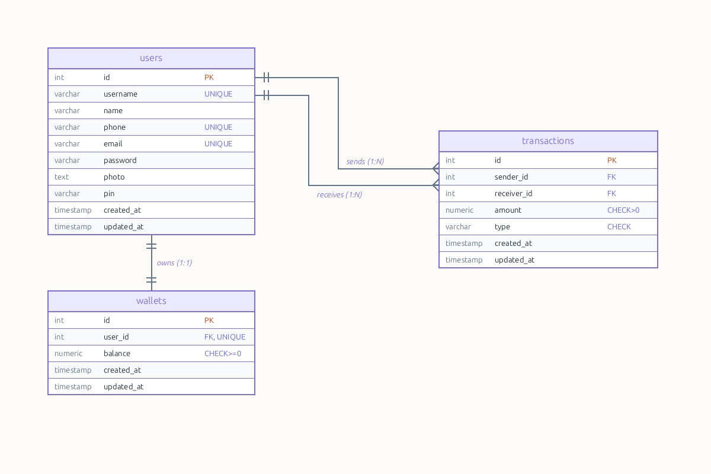

# E-wallet ERD and Database

### SQL yang disediakan:

- [x] Login
- [x] Register
- [x] Get user login information (username, email, photo)
- [x] Get/Check user PIN
- [x] Get transaction history
- [x] Get user history with option (income/expense, date range)
- [x] Get user account information (balance, income, expense)
- [x] Find receiver with pagination
- [x] Create transaction/topup
- [x] Get user profile (photo, full name, phone, email)
- [x] Change PIN
- [x] Change password
- [x] Change user profile
- [x] Atomic balance consistency for top-ups and transfers
- [x] Aggregate exploration (COUNT, SUM, AVG, MIN, MAX, HAVING, STRING_AGG)

### Perbaikan dan Peningkatan Berdasarkan Feedback:

- Isolasi Query Riwayat Transaksi: Query riwayat transaksi terisolasi per pengguna berdasarkan sender_id dan receiver_id, dengan data detail pengirim dan penerima diambil langsung melalui JOIN dari tabel users.
- Pencarian Penerima Langsung dari Tabel Pengguna: Query pencarian penerima transfer diperbarui untuk mengambil data langsung dari tabel users dengan paginasi dan filter pencarian, bukan dari tabel transactions.
- Akurasi Perhitungan Arus Kas (Inflow dan Outflow): Perhitungan kas masuk dan keluar kini mencerminkan arah transaksi secara tepat; top-up dan transfer masuk dihitung sebagai inflow, sedangkan transfer keluar dihitung sebagai outflow (top-up tidak lagi tercatat ganda sebagai outflow).
- Konsistensi Saldo dan Transaksi Atomik: Alur top-up dan transfer dibungkus dalam blok transaksi (BEGIN ... COMMIT) untuk memastikan atomisitas dan konsistensi saldo di tabel wallets bersamaan dengan pencatatan riwayat di tabel transactions.
- Keamanan Data dan Hashing: Penerapan ekstensi pgcrypto untuk hashing password dan PIN menggunakan algoritma bcrypt. Tipe data PIN diubah menjadi VARCHAR(255) untuk menyimpan hash secara aman.
- Penambahan Constraint UNIQUE dan CHECK: Constraint UNIQUE ditambahkan pada kolom username, phone, email, dan user_id di tabel wallets (relasi 1-ke-1). Constraint CHECK ditambahkan untuk format email, nomor telepon, batas saldo tidak boleh negatif (balance >= 0), nominal transaksi bernilai positif (amount > 0), serta validasi tipe transaksi ('topup', 'transfer').
- Sinkronisasi Skema SQL dengan ERD: Nama tabel diselaraskan menjadi users, wallets, dan transactions; kolom foreign key diselaraskan menjadi sender_id, receiver_id, dan user_id; entitas tidak terpakai dibersihkan pada Mermaid diagram dan file gambar erd.jpg.
- Eksplorasi Fungsi Agregasi Lanjutan: Penambahan query statistik transaksi menggunakan fungsi COUNT, SUM, AVG, MIN, MAX, penyaringan data agregasi dengan klausa HAVING, serta agregasi teks nama penerima dan jenis transaksi menggunakan fungsi STRING_AGG.

### Tampilan ERD e-wallet

